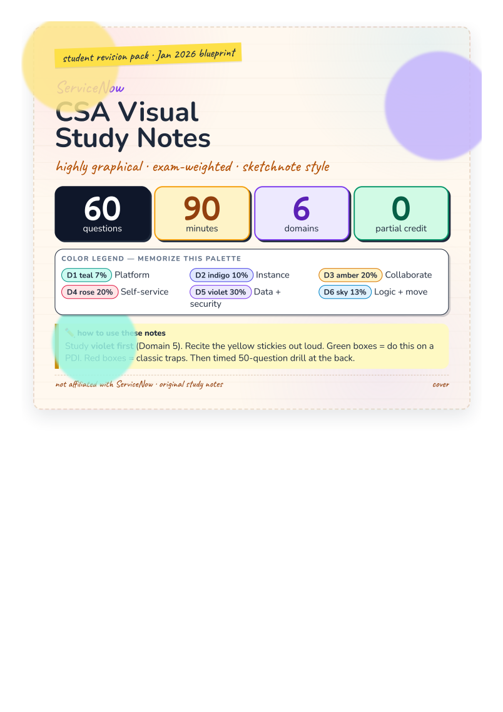

# ServiceNow CSA Workbook

**A detailed study ebook for the Certified System Administrator (CSA) exam**

Aligned to the official **CSA Mainline Exam Blueprint (updated January 2026)**.

## Graphical PDF (print / tablet)

Download this first if you want Canva-style student notes:

**[ServiceNow-CSA-Visual-Study-Notes.pdf](ServiceNow-CSA-Visual-Study-Notes.pdf)** — 15 A4 pages, color-coded by domain, sticky notes, flow diagrams, exam traps.

Rebuild from HTML (optional): `python3 pdf/build_visual_notes.py` then print `pdf/csa-visual-notes.html` to PDF.

---

This is a working study book, not a dump of exam questions. Each markdown chapter explains the topic, why it matters on the exam, how it works on the platform, and how to practice it on a Personal Developer Instance (PDI).

---

## How to use this ebook

1. Read [00 — Exam blueprint and study plan](00-exam-blueprint-and-study-plan.md) once.
2. Study domains in this order: **5 → 4 → 3 → 6 → 2 → 1** (heaviest first).
3. After each domain chapter, complete the matching labs in [08 — Hands-on lab workbook](08-hands-on-lab-workbook.md).
4. Drill the comparison tables in [07 — High-yield comparisons](07-high-yield-comparisons.md) until you can explain each pair out loud.
5. Take the practice set in [09 — Practice questions](09-practice-questions-and-explanations.md) timed (90 minutes).
6. Use [10 — Glossary, tables, and exam day](10-glossary-tables-and-exam-day.md) as a last-week review.

Official ServiceNow training and product docs remain the source of truth. Use this workbook to organize study, not as a replacement for a PDI and Now Learning.

---

## Table of contents

| Ch | File | Domain | Exam weight |
| --- | --- | --- | ---: |
| 00 | [Exam blueprint and study plan](00-exam-blueprint-and-study-plan.md) | Logistics | — |
| 01 | [Platform overview and navigation](01-platform-overview-and-navigation.md) | Domain 1 | 7% |
| 02 | [Instance configuration](02-instance-configuration.md) | Domain 2 | 10% |
| 03 | [Configuring applications for collaboration](03-configuring-applications-for-collaboration.md) | Domain 3 | 20% |
| 04 | [Self-service and automation](04-self-service-and-automation.md) | Domain 4 | 20% |
| 05 | [Database management and platform security](05-database-management-and-platform-security.md) | Domain 5 | **30%** |
| 06 | [Data migration and integration](06-data-migration-and-integration.md) | Domain 6 | 13% |
| 07 | [High-yield comparisons](07-high-yield-comparisons.md) | All | — |
| 08 | [Hands-on lab workbook](08-hands-on-lab-workbook.md) | All | — |
| 09 | [Practice questions and explanations](09-practice-questions-and-explanations.md) | All | — |
| 10 | [Glossary, tables, and exam day](10-glossary-tables-and-exam-day.md) | All | — |

---

## Official exam facts (January 2026)

- **60** questions (multiple choice and multiple select)
- **90** minutes
- Partial credit is **not** given on multi-select
- Cut score is **not** publicly a flat 70%
- Recommended path: *Welcome to ServiceNow* + *ServiceNow Administration Fundamentals*
- Hands-on: 3–6 months of admin experience, or equivalent PDI practice

---

## Disclaimer

This workbook is original study material based on the public CSA exam specification and publicly documented platform behavior. It is not affiliated with ServiceNow. Features can change by release. Confirm details on [docs.servicenow.com](https://docs.servicenow.com) for the release named on your exam voucher.
